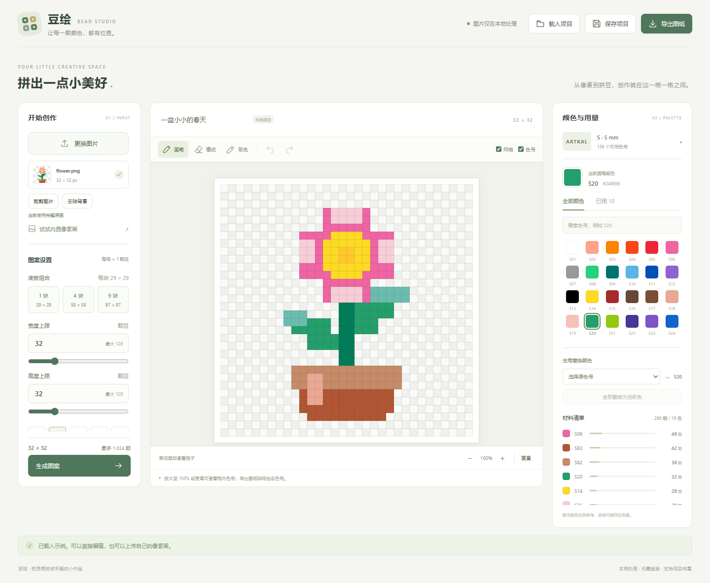

# 豆绘 · 拼豆图纸工作台

一个浏览器本地运行的 Vue Demo：将像素画匹配到真实 Artkal S 色号，编辑图案、统计用量，并下载可使用的 PNG 图纸。



## 已实现功能

- PNG/JPEG 上传、拖放和原创像素画示例；单文件最多 10 MiB（10×1024×1024 字节）。
- 宽高滑块和数值输入（1～128），提供 16 / 32 / 48 / 64 / 128 方形上限，以及 1 / 4 / 9 块 29×29 底板组合；图案保持比例放入，不拉伸。
- 上传后自动打开矩形裁剪：拖动框选主体、移动选框、四角缩放、精确输入像素范围，也可恢复整图。确认后点击生成才应用。
- 内置官方 RGB 表中的 156 个 Artkal S 色号，使用 sRGB → Lab（D65）→ CIE76 色差匹配。
- 三种像素化风格：复古像素风（最近邻）、色块平滑（区域平均）、轮廓优先（区域主色）。
- 原图背景处理：纯色连通背景去除、点选背景、涂抹擦除/恢复、撤销/重做、容差与笔刷大小、预览缩放。支持一键自动主体抠图，模型随项目提供、按需加载。
- 全透明和擦除区域留空；半透明与白底合成；空格不计材料用量。
- 画笔、橡皮、吸色、全局替色、撤销、重做和缩放。
- 色号搜索、已用颜色筛选、实时各色用量和总颗数。
- PNG 图纸导出：完整网格、色号、行列编号、颜色图例和用量。
- 本地 JSON 项目保存与载入，携带图案、色表快照和生成参数。
- 覆盖未保存成果时提示，坏项目文件不覆盖当前工作。

所有图片转换都在浏览器中完成，无业务服务器、数据库、账户、API Key 或远程 AI 调用。

## 环境要求

| 工具 | 固定版本 |
| --- | --- |
| Node.js | **24.13.0** |
| npm | **11.6.2** |
| Vue | 3.5.43 |
| Vite | 8.3.4 |
| @vitejs/plugin-vue | 6.0.10 |
| onnxruntime-web | 1.24.3 |

Node 版本记录在 `.nvmrc`，npm 版本记录在 `package.json`。`.npmrc` 启用严格引擎校验，版本不符时会拒绝安装。所有依赖及间接依赖由 `package-lock.json` 固定。

本项目不依赖 Python，因此没有 pip 使用的 `requirements.txt`；对应的说明是 [REQUIREMENTS.md](REQUIREMENTS.md)，实际依赖安装由 npm 锁文件管理。

## 本地启动

从 GitHub 克隆或下载完整源码后，进入包含 `package.json` 的项目目录。仓库尚未上传；最终地址和验收提交 SHA 应在上传时补充。

```sh
node --version
npm --version
npm ci
npm run model:download
npm run dev
```

打开终端打印的 Local 地址，通常为 **http://127.0.0.1:5173/**。首次安装依赖需要网络，启动后图片处理不依赖外部服务。不要直接双击 `index.html`。

如安装版本不一致，请先安装上表所列版本。使用 nvm 的用户可选择安装并切换到 `24.13.0`；Node 版本管理器不是必需依赖。

## 测试、构建与预览

```sh
npm test
npm run build
npm run preview
```

- `npm test`：Node 内置测试器运行核心模块的 24 项基础检查。
- `npm run build`：生成 `dist/`。
- `npm run preview`：检查构建产物，通常地址为 **http://127.0.0.1:4173/**，以终端为准。
- 停止本地服务：在对应终端按 `Ctrl+C`。

这是本地 Demo，不要求网站部署。不要在 Vite 服务仍运行时执行 `npm ci`：Windows 可能因原生依赖正在使用而拒绝替换文件。先停止服务，再安装。

## 使用方法

1. 打开后会加载 32×32 小花示例，也可以上传自己的 PNG/JPEG 像素画。
2. 上传后先截取需要的主体区域，或取消使用完整图片；左侧“裁剪图片 / 调整裁剪”可再次打开。可以再打开“去除背景”处理原图；选择底板组合或调整宽高上限、像素风格，点击“生成图案”。裁剪、背景处理和参数修改不会立即覆盖当前画布。
3. 在右侧选择色号，用画笔、橡皮和吸色工具调整图案。快速拖动会补齐中间格子。
4. 全局替色：选择原色号，再选择当前画笔颜色，点击“全部替换为当前色”。
5. 右侧实时显示材料用量。预览放大至 150% 或更高时显示格内色号。
6. 点击“导出图纸”，下载 PNG；导出始终显示色号，与预览缩放及网格开关无关。
7. 点击“保存项目”，下载 `.beads.json`。以后使用“载入项目”继续编辑。

### 编辑和保存规则

- 一次拖动画笔或一次全局替色各算一步撤销。
- 撤销后执行新编辑会清空重做记录。
- 重新生成会清空编辑历史；存在手工修改或未保存成果时先提示确认。
- 已应用的裁剪范围（原图像素坐标及原尺寸）会随生成参数保存，旧版无裁剪参数项目仍可读取。项目文件不保存原图和历史。恢复项目后可编辑、统计和导出；重新转换需再次上传原图。
- 保存后表示已发起下载，浏览器不向网页保证用户最终保存成功。
- 关闭或刷新页面时，未保存工作会触发浏览器提示；没有云端自动保存。

快捷键：`B` 画笔、`E` 橡皮、`I` 吸色、`Ctrl/Cmd+Z` 撤销、`Ctrl/Cmd+Shift+Z` 或 `Ctrl+Y` 重做、`Ctrl/Cmd+S` 保存项目。输入框内不接管快捷键。

## 模块结构

```text
src/
  App.vue                       三栏工作台
  main.js / style.css           入口和样式
  components/
    BackgroundEditor.vue        原图背景擦除/恢复和纯色去除
    ImageCropper.vue            原图矩形裁剪弹窗
    PixelCanvas.vue             画布显示和指针坐标
    AppIcon.vue                 本地图标
  composables/useStudio.js      页面状态、用户操作和确认流程
  core/
    sizing.js                   底板容量与保持比例的尺寸适配
    pixelate.js                 最近邻、区域平均与主色采样
    background.js               非破坏蒙版、笔刷与连通颜色去除
    crop.js                     裁剪区域校验和框选几何
    color.js                    Lab 转换与最近颜色匹配
    image.js                    文件头校验、图片解码
    pattern.js                  网格采样、生成和用量统计
    editor.js                   编辑事务、历史和连续线段
    project.js                  项目 JSON 校验、保存和读取
    render.js                   画布预览、PNG 图纸和下载
  data/artkal-s.json            内置色表及来源信息
public/samples/                 原创样例与透明处理样例
tests/*.test.js                核心模块与新功能基础检查
docs/                          接口、素材来源、AI 报告和用户输入记录
```

没有 HTTP 接口。可导入的 JavaScript 模块及数据约定见 [模块接口与测试说明](docs/模块接口与测试说明.md)，方便后续编写接口和功能测试。

## 已完成的基本验证

验证日期：2026-10-12 至 2026-10-13。环境：Windows x64（系统版本 10.0.26200），Node 24.13.0、npm 11.6.2、Chrome 154.0.8037.98。

- 使用锁文件重新安装依赖；本次使用本机缓存进行 `npm ci --offline`。
- 24 项核心检查通过，生产构建通过。
- Chrome 中检查了上传、生成、连续绘制、吸色、擦除、全局替色、撤销重做、项目下载与恢复、无效 JSON 保护及 PNG 下载。
- 检查了半透明、全透明、JPEG 输入、128×128 图纸导出和放大后的格子定位。
- 新增裁剪检查：上传自动打开、框选/移动/缩放、数值输入、确认与取消、恢复整图、生成比例和项目参数保存。
- 新增底板、宽高滑块、三种风格、纯色背景去除、内部同色细节保留、涂抹恢复及项目参数检查。
- 页面检查期间没有捕获到 JavaScript 错误；390 px 宽度没有横向页面溢出。

这些是基本冒烟检查，不代替后续完整功能测试、跨浏览器兼容性和长时间编辑压力测试。请按 [验收建议](docs/模块接口与测试说明.md) 继续安排。

## 色表来源与已知限制

[Artkal 官方 S 系列色表](https://www.artkalfusebeads.com/pages/s-color-chart)中的 RGB PDF 提供了本 Demo 使用的数值。实际范围为 **S01～S159，排除无 RGB 数值的 S41、S42、S63**，共 156 色；不代表某一款套装包含全部这些颜色。

详细文件、哈希、同色号处理及素材说明见 [素材与色表来源](docs/素材与色表来源.md)。应用没有官方品牌背书。

- 数字色表是近似值，屏幕颜色不保证与实体豆完全一致；采用 CIE76，不宣称是实物测色或最优视觉算法。
- 原图解码前限制为 **1600 万像素**，避免小体积压缩图片占用过多内存；文件大小限制独立生效。
- 背景处理支持本地 Anime Segmentation 自动主体抠图、颜色连通去除和手动修补；细线、多个主体和复杂背景可能识别不准。没有 PDF、实物尺寸打印或 A4 分页。
- 主要面向桌面；手机可查看和基础操作，但未完成完整触屏验收。
- 撤销历史仅保存在内存，长时间大量编辑会增加内存使用。撤销回到已保存内容时仍保守显示“未保存”。
- 项目文件只接受当前 schemaVersion=1 和 S 数字色号格式。

## 常见问题

**`npm ci` 提示 EBADENGINE**：Node/npm 与固定版本不符。检查 `node --version`、`npm --version`，再切换版本。

**安装提示 EPERM / 文件被占用**：先停止本项目的开发或预览服务，再重试；不要先删除锁文件或强制升级依赖。

**安装失败或缺少依赖**：确认完整下载了 `package.json` 和 `package-lock.json`，网络能够访问 npm。使用 `npm ci`，不要混用其他包管理器。

**没有生成新画布**：上传和修改参数后需要点击“生成图案”；尺寸上限、背景处理或像素化风格改变后也需要重新生成。

**下载被浏览器拦截**：检查浏览器下载提示与多文件下载权限，稍后再次点击下载。

**导出色号太小**：以 PNG 原始分辨率查看；每格固定 32 px，缩略图不是实际可读性依据。

## 交付文档

- [项目规划](项目规划.md)
- [环境与依赖复现规范](REQUIREMENTS.md)
- [模块接口与测试说明](docs/模块接口与测试说明.md)
- [素材与色表来源](docs/素材与色表来源.md)
- [AI 编程报告（提交版）](提交文档/01_AI编程报告.md)
- [AI 用户输入记录（提交版）](提交文档/02_AI对话记录.md)

GitHub 为计划中的主要验收入口，上传前需要确定仓库归属、名称和可见性；当前代码尚未上传。源码压缩包作为补充交付，不包含 `node_modules/`、临时测试工具或私人配置。


## 尺寸、风格与背景处理指南

### 用底板控制豆子预算

每块按 29×29 格计算，1 / 4 / 9 块对应 29×29 / 58×58 / 87×87 上限。也可分别拖动宽高滑块或输入数值；图案保持裁剪区域的比例，不补满或拉伸到整个矩形。

例如 2:1 横图放入 4 块底板，会生成 58×29；1:2 竖图生成 29×58。因整数格子必须取整，比例可能存在一格左右的近似。尺寸预算显示最多格子数，真正的豆子数量以生成后右侧统计为准。底板估计按矩形摆放计算，不优化旋转或不规则空格。

### 选择像素化风格

| 风格 | 实际算法 | 适用场景 |
| --- | --- | --- |
| 复古像素风 | 每格取最近邻像素，保持取到的原始颜色 | 已有像素画、硬边缘素材 |
| 色块平滑 | 计算该格覆盖区域的加权平均颜色 | 渐变或细碎颜色较多的图片 |
| 轮廓优先 | 对区域颜色分组，选占比最大的颜色组并取平均 | 线稿、卡通，减少前景和背景混成新颜色 |

所有方式都在最后匹配到真实色号。主色采样不是边缘识别模型，不保证保住所有细线；降低尺寸本身会损失细节。平滑和主色模式仅在可见像素覆盖至少半格时放豆；完全透明或完全擦除的格子始终留空。

### 先去背景，再转拼豆

1. 上传和裁剪后，点击左侧“去除背景”。背景编辑针对原图，裁剪范围仍单独保留。
2. 简单纯色背景先试“去除纯色背景”：参考四角中最接近的一组颜色，去掉与它们连通的相似色区域。
3. 未去净的连通背景用“点选背景”点击，调整颜色容差后再次操作。已封闭在主体内部的同色细节不会仅因同色而被全图删除。
4. 复杂背景用“擦除背景”涂抹。误删可用“恢复原图”笔刷、撤销或“恢复全部原图”。恢复笔刷恢复原图，不是只恢复最近一步。
5. 可放大预览、缩小笔刷修整边缘；“应用背景处理”后点击“生成图案”，才能更新用量和导出。

原图从不被覆盖。项目文件保存生成后的格子及风格、尺寸上限、背景处理标记，不包含原图、背景蒙版或其历史；载入项目可继续编辑结果，重新做原图背景处理需要再次上传。旧项目文件仍可在当前版本打开。

背景编辑的撤销缓存按图像大小控制在约 32 MiB，最多 12 步（不含当前蒙版、操作中快照及算法工作内存）。四角属于主体、背景与主体同色相连等情况仍可能误删，请在应用前检查，可用恢复笔刷修正。

可上传 `public/samples/background-demo.png` 快速测试：白背景有 2,000 个像素，主体含封闭的白色细节。原尺寸生成时，去背景前为 2,400 颗、去除后为 400 颗，内部白色保留。界面示例见 [背景处理截图](docs/background.png)。


## 一键自动主体抠图

上传图片 → 去除背景 → **一键抠图** → 用“擦除背景”补涂残留，用“恢复原图”找回误删部分 → 应用背景处理 → 生成图案。

模型 Anime Segmentation（ISNet）约 176 MB 随完整源码包提供；首次点击从本机加载模型及约 12.4 MB WASM 推理引擎，不上传图片、不访问第三方推理服务。无需额外安装 Python 或申请接口。保持 `public/models/` 完整，使用支持 WebAssembly、Web Worker、OffscreenCanvas 的现代 Chrome / Edge，通过 Vite 地址访问，不能双击 HTML 启动。

识别在 Worker 中执行，显示加载进度和当前阶段，可点击“取消自动抠图”。模型加载或推理失败会保留原有修改，仍可用纯色去除和笔刷。再次自动识别会提示替换当前背景修改；一次自动抠图作为一步撤销。关闭窗口会释放推理资源，重新打开时需要重新初始化。

模型识别显著主体，输出以 0.5 阈值转换为拼豆二值蒙版，细发丝、像素画、小物体和复杂背景可能不准确；结果需要检查和手动修补。原图透明度仍保留。详见 [模型来源、校验和与许可](public/models/README.md)，[界面截图](docs/background-ai.png)。


## 2026-10-13：切换 Anime Segmentation

当前“一键抠图”使用 SkyTNT Anime Segmentation 官方 ISNet ONNX，针对动漫角色。参考用户提供的 `chunk_photo/anime-segmentation-main/inference.py` 接入：1024×1024 等比例缩放居中补黑边、RGB / 255，输出去补边后还原尺寸；不再使用 U2NetP 的 ImageNet 归一化及输出拉伸。浏览器缩放与上游 OpenCV 插值存在数值差异，透明输入先合成白底用于识别，最终仍保留原图透明度。

仍使用现有一键抠图按钮，支持取消、撤销/重做、擦除/恢复。模型更大，加载与 CPU 推理更慢；不保证所有动漫或像素画都准确。模型和图片均在本机处理，无 Python 服务。

GitHub 克隆后，运行 `npm ci`、`npm run model:download`、`npm run dev`。模型约 176 MB，不应直接提交普通 GitHub 仓库；`.gitignore` 已排除权重和用户提供的参考源码目录。下载命令固定官方模型版本并校验 SHA256。完整本地源码压缩包包含模型，可直接运行。请勿用 GitHub 自动生成的源码 zip 代替完整模型包而跳过下载。构建前需准备模型，否则 Vite 可构建但一键抠图不可用。

来源、版本及校验值见 [模型说明](public/models/README.md)。

## 修补模型误删的手臂 / 衣服

查看原图裁剪或背景处理画面时，鼠标放在图片区域，按 **Ctrl＋滚轮** 以鼠标位置为中心放大 / 缩小（适应尺寸的25%～800%）；按住 **空格＋鼠标左键拖动** 平移，松开后继续裁剪或使用笔刷。点击“适应窗口”恢复居中和初始缩放。视图操作不改变裁剪参数、背景蒙版、撤销记录或导出尺寸；笔刷/裁剪拖动过程中暂停缩放，避免误修改。

一键抠图后选择 **点选保留**，在淡显的原图中点击误删部分，按原图相近且连通的颜色恢复；颜色容差越大范围可能越大，也可能带回背景。不同色块可以分别点击，边缘用“恢复原图”笔刷精修，多恢复的背景用擦除清理。每次点选可单独撤销。

“显示原图参考”把已删除区域以30%原透明度显示，方便定位；它只是辅助显示，既不改变蒙版，也不参与生成或导出。取消勾选检查真实透明结果。选中点选保留或恢复笔刷时自动打开参考。

此改进为交互修补，不改变模型识别能力。对 saber 示例，手臂概率远低于0.5，甚至低于部分背景；直接降阈值不能可靠地找回手臂，因此本次没有增加全局阈值滑块。
