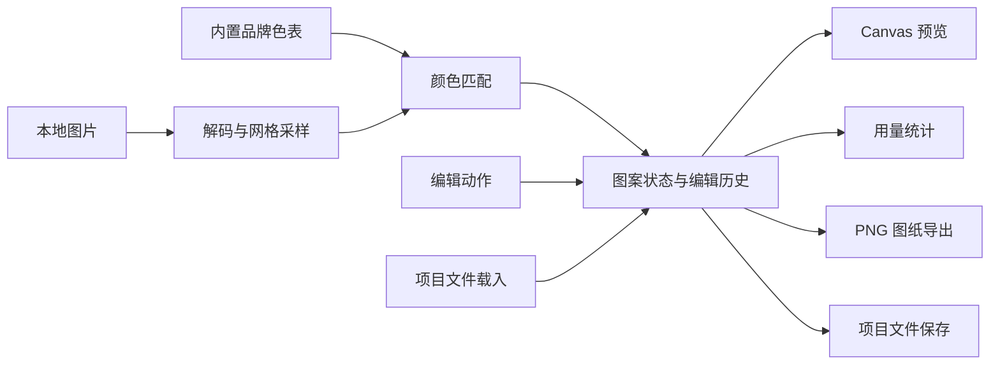

# 拼豆图纸工具：项目设计与开发流程

> 更新日期：2026-10-12。Demo 已按本设计完成实现；本文件保留需求确认与设计依据，实际运行、版本与验收结果以 README.md 为准。
> 已确认的产品决定与尚待核验的技术细节分别列出。后续出现影响产品方向、范围或行为的问题，先询问用户，不擅自变更。

## 1. 目标和已确认范围

今天完成可本地运行的 Demo，无需上线。用户熟悉 Python；项目采用 Vue 3 + JavaScript + Vite，图片在浏览器本地处理，以 Canvas 支撑画布绘制。

依据《笔试题.png》，核心目标是：上传像素图片，匹配真实拼豆色号，生成带网格线和色号的可下载图纸。AI 用于开发协作，不要求产品运行时调用 AI。

| 事项 | 已确认方案 |
| --- | --- |
| 品牌 | Artkal S 系列，优先核验官方普通不透明色数据 |
| 页面 | 电脑端、浅色三栏：左侧参数、中间画布、右侧色表与用量 |
| 输入 | PNG/JPEG 像素画 |
| 网格 | 用户指定宽度，保持图片比例计算高度，最近邻缩放 |
| 透明度 | 全透明像素留空，半透明像素按白底合成后匹配 |
| 编辑 | 画笔、橡皮、吸色、全局替换某色、撤销与重做 |
| 辅助 | 缩放、各色用量及总用量统计 |
| 图纸 | 导出 PNG，含网格、色号；暂不做 PDF |
| 项目文件 | 本地保存与载入当前图案、色表和参数，不包含原图 |
| 重新生成 | 有手工修改时先提示确认；确认重新生成后清空撤销记录 |
| 恢复项目 | 可继续编辑和导出；重新转换需要再次上传原图 |

本轮不包含照片优化、自动抠图和线上部署。其他未确认功能不自动纳入第一版。

## 2. 使用流程与页面布局

上传图片 → 设置网格宽度 → 自动匹配品牌色号 → 预览与编辑 → 查看材料用量 → 导出图纸或保存项目。

另一入口为载入项目文件，恢复图案后直接进入编辑。

```text
┌─────────────────────────────────────────────────────────┐
│ 工具名称                 载入项目  保存项目  导出 PNG     │
├──────────────┬────────────────────────┬─────────────────┤
│ 上传与原图   │ 画笔 橡皮 吸色 撤销 重做│ 品牌与颜色列表  │
│ 网格宽度     │                        │ 当前选中色号    │
│ 图案尺寸     │      拼豆编辑画布      │ 全局颜色替换    │
│ 生成按钮     │                        │ 各色用量        │
│ 状态与提示   │ 缩放及当前格子信息     │ 总颗数/颜色数   │
└──────────────┴────────────────────────┴─────────────────┘
```

布局细节属于设计示意。空状态提示上传图片或载入项目；失败状态应解释原因并保留已有成果。参数修改后应清晰区分“待生成参数”和“当前图案参数”，避免用户误以为画布已更新。

## 3. 总体架构

Vue 负责页面、用户输入与状态展示，独立 JavaScript 模块负责图像转换、匹配、编辑、统计及项目读写。Canvas 负责显示和 PNG 图纸绘制。



关键约定：图案数据是唯一事实来源。导出不重新匹配颜色，统计不从截图识别，编辑操作不直接修改画布而绕过图案状态。缩放只影响显示，不改变格数或用量。

## 4. 模块与接口设计

以下接口为规划中的职责约定，不是已经实现的代码。

| 模块 | 对外接口意图 | 输入 → 输出 | 内部负责 |
| --- | --- | --- | --- |
| 图片输入 | decodeImage | 文件 → 像素数据、宽高 | 文件类型及尺寸校验、解码失败处理 |
| 网格转换 | sampleGrid | 像素数据、目标宽度 → 颜色网格 | 高度计算、最近邻取样、透明度处理 |
| 品牌色表 | getPalette | 色表标识 → 标准色表 | 数据与来源、版本、唯一色号验证 |
| 颜色匹配 | matchGrid | 颜色网格、色表 → 图案 | 颜色距离计算、重复颜色缓存、确定性选色 |
| 编辑与历史 | applyEdit / undo / redo | 图案、编辑动作 → 新状态 | 画笔、擦除、全局替色及历史管理 |
| 画布显示 | renderPreview / hitTest | 图案、视图参数 → 画面或格子坐标 | 网格、文字、缩放后坐标换算 |
| 用量统计 | countBeads | 图案 → 各色数量与总数 | 忽略空格、从最新图案计算 |
| 图纸导出 | exportPng | 图案、色表、版式 → PNG 文件 | 完整图案、网格、色号、图例与用量排版 |
| 项目读写 | serializeProject / parseProject | 项目状态 ↔ JSON 文件 | 版本识别、数据校验、色表快照保存 |
| 页面状态 | 组织上述接口 | 用户事件 → 界面与处理状态 | 加载、失败、确认提示、当前工具与选中色 |

吸色读取已有格子的色号，画笔使用所选品牌色号，橡皮产生空格。全局替色作用于图案中所有指定色号的格子，不改变色表本身。

编辑模块独立于 Vue 和 Canvas，便于验证算法与撤销行为；页面无需了解颜色距离的内部计算。第一版不需要为每个模块建立独立服务。

## 5. 数据结构与一致性

| 数据 | 必要字段 |
| --- | --- |
| 色表 | id、brand、series、version、source、colors |
| 单个颜色 | code、name（如有）、RGB/HEX、来源依据 |
| 图案 | width、height、cells、paletteId、paletteVersion、生成参数 |
| 编辑状态 | 当前图案、历史、当前工具、选中色号、视图缩放 |
| 项目文件 | schemaVersion、图案、所用色表快照、生成参数 |

格子按行存储，使用色号表示有效格子，使用空值表示空格。格子总数必须等于宽乘高；所有非空色号必须存在于该项目色表中。保存色表快照是为了使项目恢复后保持颜色含义，不依赖未来内置色表变化。

项目文件不保存原图和运行中的撤销历史；用户已确认。读取时先完整校验，成功后再替换当前状态，避免坏文件损坏已有工作。

已确认：重新生成前如有手工修改则提示确认，取消时保留原图案，确认生成后清空历史。实现时还需区分“图案被编辑”和“项目尚未保存”两种状态。

## 6. 素材和数据清单

| 素材 | 获取方案 | 完成标准 |
| --- | --- | --- |
| Artkal S 官方色表与 RGB 数据 | 从官方页面下载并核验 | 色号、数字颜色、版本和来源能对应 |
| 第一版颜色集合 | 从已核验的普通不透明色选择 | 明确列出包含哪些色号，不混入其他系列或虚构颜色 |
| 像素画样例 | 自制小型图案 | 至少覆盖单色、多色、透明区域与矩形尺寸 |
| 边界样例 | 构造测试数据或小图 | 覆盖半透明、极小尺寸、较大网格和无法解码的文件 |
| 字体与图标 | 优先系统字体及简单文字按钮 | 清晰可读，无需购买素材 |
| 参考界面 | 本文三栏布局 | 不依赖外部设计稿才能开始 |

已确认官方页面存在 RGB 色表入口：[Artkal S 色表](https://www.artkalfusebeads.com/pages/s-color-chart)。实施时已从官方 PDF 文本层提取并校验 156 个 S 系列数字色号；S41/S42/S63 没有 RGB，已排除。来源与使用边界见 docs/素材与色表来源.md。

数字色表用于近似匹配，不等同于实物测色。README 和 AI 报告需如实说明来源和屏幕显示误差。若数字数据存在缺失或来源问题，向用户说明后再决定替代方案。

## 7. 接口、依赖和开发工具

### 产品运行时

本地文件输入、浏览器画布、文件下载即可覆盖当前范围。无需业务服务器、数据库、云存储、外部 AI 接口或 API Key。色表随应用提供，转换时不联网请求色表。

### 开发时

| 工具或依赖 | 用途 | 说明 |
| --- | --- | --- |
| Vue 3 | 页面与响应式状态 | 已确认 |
| JavaScript | 业务逻辑和算法 | 已确认，核心逻辑与页面分离 |
| Vite、Node.js、npm | 本地开发、依赖管理和构建 | 实施前核对兼容版本并记录锁文件 |
| Canvas 与浏览器文件能力 | 预览、像素处理、PNG 和 JSON 下载 | 不需要额外图像服务 |
| 核心逻辑测试工具 | 匹配、编辑历史、项目读写验证 | 具体工具随工程初始化确定 |
| 浏览器开发者工具 | 交互、文件下载和性能检查 | 实测后决定是否需要后台线程 |
| AI 助手 | 需求拆解、实现协作、检查和文档 | 记录实际使用的工具与真实对话 |
| Git | 开发阶段留存可回退版本 | 最终压缩包或仓库交付方式仍待确认 |

Vue 官方文档介绍了基于 Vite 的工程方式：[Vue 快速开始](https://vuejs.org/guide/quick-start.html)。已验证版本为 Vue 3.5.43、Vite 8.3.4、Node 24.13.0、npm 11.6.2，完整依赖见锁文件。

建议先不增加路由、全局状态库和大型 UI 依赖；当前只有一个工作台页面。当前算法采用 Lab/CIE76，已完成最大网格导出冒烟；更广泛的性能测试留待后续安排。

## 8. 开发顺序与阶段产物

| 阶段 | 工作内容 | 通过条件 |
| --- | --- | --- |
| 0. 规划收敛 | 确认范围、界面、转换与保存规则 | 本文已确认项固定，未决项有记录 |
| 1. 数据准备 | 核验官方色表，整理基础数据与样例 | 有真实可追溯的色号与数字颜色集合 |
| 2. 工程与页面 | 初始化 Vue 工程，实现三栏结构和状态入口 | 本地可启动，空状态和操作区清楚 |
| 3. 核心闭环 | 上传、采样、匹配、画布预览、PNG 导出 | 一张样例可生成带网格和色号的图纸 |
| 4. 编辑能力 | 画笔、橡皮、吸色、撤销重做、全局替色、缩放 | 编辑后显示与导出一致，历史行为正确 |
| 5. 辅助能力 | 用量统计、项目保存载入、重新生成提示 | 数量正确，保存后可恢复并继续编辑 |
| 6. 联合验收 | 输入异常、缩放坐标、图纸可读性、较大图性能 | 无阻断核心使用的问题 |
| 7. 交付整理 | README、AI 报告、对话记录、素材来源 | 新环境可按 README 运行，交付内容齐全 |

当天工期的风险集中在色表整理、编辑历史和大图导出。优先完成核心闭环，再扩展已确认功能。若时间不足需调整范围，先与用户讨论，不静默删减。当前不承诺未经测量的准确工时。

## 9. 验收清单

- 上传 PNG/JPEG 像素图后可生成指定宽度的图案，高度按确认规则保持比例。
- 全透明格子留空；半透明按白底合成；有效格子全部使用所选品牌的真实色号。
- 同样输入与参数产生一致结果；匹配算法和色差依据可解释。
- 画笔与橡皮拖动后无意外漏格；缩放后操作落在正确格子。
- 全局替色只修改目标色号；撤销和重做能恢复相应图案。
- 编辑后各色数量和总量同步更新，空格不计豆数。
- 导出的 PNG 可打开，整幅图案不被裁切，网格和色号在原始分辨率下可读，并包含颜色对照信息。
- PNG 不依赖当前屏幕缩放或可见画布范围，预览、统计和下载采用同一图案版本。
- 项目保存载入后，格数、色号和颜色保持一致；可继续编辑、统计和导出。
- 无效项目文件不会覆盖已有图案；重新生成的确认和取消行为符合约定。
- 按 README 在干净环境安装启动成功；无需私人 API Key 或私有服务。

重点测试核心模块接口，而非为每个按钮编写重复实现逻辑的测试。浏览器联调覆盖一条完整使用流程和关键失败路径。

## 10. 交付文档与 AI 协作记录

| 文件 | 内容 |
| --- | --- |
| README.md | 环境要求、安装启动、使用步骤、已实现功能、限制和数据来源 |
| 项目规划.md | 本文，记录范围、模块、流程和决策 |
| docs/AI编程报告.md | 实际使用的 AI 工具、协作复盘、1～2 个真实难点及解决验证过程 |
| docs/AI对话记录.md 或记录目录 | 保存真实用户输入及上下文，按题目允许方式缩减过长 AI 输出 |
| docs/素材与色表来源.md | 来源链接、版本、颜色集合、数字颜色获得方式及使用条件 |

规划阶段也属于 AI 协作过程，应保留本轮提问与用户回答。决策摘要不能代替完整对话记录，不虚构 Prompt、Bug 或验证结果。

最终以 GitHub 仓库作为验收入口，同时提供源码压缩包；用户已明确无需部署上线。完整 README 和环境要求文档纳入交付，工程实现时提交 package.json、package-lock.json 及固定 Node.js 版本文件。

## 11. 补充确认规则与技术核验项

以下产品规则已由用户确认。GitHub 验收为明确要求，压缩包作为补充。

| 已确认事项 | 规则 | 原因 |
| --- | --- | --- |
| 图像与网格上限 | 宽高均最多 128 格、文件最多 10 MB；实测验证处理能力 | 避免大图绘制和导出占用过多内存；解码像素上限也需单独验证 |
| 编辑历史 | 一次拖动画笔作为一步；全局替色作为一步；撤销后新编辑清空重做；项目不保存历史 | 保持操作直观，控制项目文件内容 |
| 图纸版式 | 彩色格子、对比色文字、行列编号、色号图例与颗数；留空格保留网格 | 便于实际拼豆和材料准备 |
| 边界操作 | 覆盖或载入另一项目时，若当前修改未保存则提示 | 避免误丢编辑结果 |
| 交付形式 | GitHub 仓库用于验收，另提供源码压缩包 | 上传仓库不等于部署网站 |

实施结果：官方色表已整理为 156 色，使用 Lab/CIE76；固定版本安装、构建与最大 128×128 PNG 导出已经过基本检查。完整跨浏览器及性能测试由后续验收安排。

## 12. 已确认决策记录

1. 最初阶段先规划并输出 Markdown；用户随后明确授权按本设计实现 Demo。
2. 2026-10-12 当天完成本地 Demo，无需上线，希望包含编辑与辅助功能。
3. 图片在浏览器本地处理。
4. 使用 Vue 3 + JavaScript + Vite。
5. 首个品牌选择 Artkal S 系列，核验官方普通不透明色数据。
6. 使用电脑端浅色三栏布局。
7. 接受画笔、橡皮、吸色、全局替色、撤销重做、缩放、用量统计、PNG 导出和项目保存载入。
8. 输入 PNG/JPEG 像素画，指定宽度并保持比例，最近邻缩放，全透明留空，半透明合成白底。
9. 暂不做 PDF、照片优化与自动抠图。
10. 有手工修改时重新生成先提示确认，确认后清空历史。
11. 项目保存图案、色表与参数，不含原图；恢复后重新转换需要重新上传原图。

12. 文件最多 10 MB，网格宽高均不超过 128 格。
13. 一次拖动画笔或一次全局替色各计一步历史；撤销后新编辑清空重做；项目不保存历史；覆盖未保存工作前提示。
14. PNG 包含彩色网格、色号、行列编号、图例和颗数，空格保留网格。
15. GitHub 仓库用于后续验收，附源码压缩包；补齐 README 和环境要求说明，实际工程使用 npm 锁文件固定依赖。

## 13. 环境复现与 GitHub 交付补充

已更新 [README.md](./README.md) 与 [REQUIREMENTS.md](./REQUIREMENTS.md) 为实际 Demo 文档，覆盖安装、启动、测试、构建、使用、验收与固定版本。已生成依赖锁文件并验证基本运行。Vue/JavaScript 使用 package.json 和 package-lock.json 管理依赖，不使用 Python 的 requirements.txt。上传前确认仓库名称、归属和可见性。


## 14. Demo 实施结果

2026-10-12 已按模块完成 src/core、src/composables、src/components 与 Vue 工作台。基本测试 9 组及浏览器冒烟通过；后续接口与完整功能测试由用户安排。新增技术预算：原图解码上限 1600 万像素。GitHub 上传仍待确定仓库信息；未部署网站。


## 15. 新增需求：128 快捷项与矩形裁剪

用户要求补齐 128 格快捷按钮，并允许上传后截取主体，减少无用背景。现已实现上传后裁剪弹窗、直接框选、移动、四角调整、像素范围输入、恢复整图和取消。生成按裁剪区域比例采样，原图不被破坏，裁剪参数随生成结果保存。宽高最多 128 格仍适用，不加入自动抠图。基本测试更新为 12 组，新增浏览器裁剪流程检查通过。

## 16. 已确认并实现：尺寸预算、像素化和背景处理

用户新增并确认：29×29 单块底板，1/4/9 块组合为 29/58/87 的方形上限，保持图像比例；背景先使用本地擦除、恢复和纯色连通去除，不接入 AI 语义模型。

实现：宽高滑块及数值上限，实际尺寸与豆子上限显示；最近邻、区域平均、区域主色三种算法；原图背景蒙版、点选相似背景、圆形笔刷、恢复、撤销重做、容差和缩放。生成链路为原图 + 裁剪 + 背景蒙版 → 像素化 → 品牌色号映射 → 编辑/统计/导出。尺寸与风格参数保存到项目，原图及背景蒙版不保存。旧项目仍可读。

初版不做背景处理和风格选择的范围记录已由本次用户指令扩展。实现未增加模型、付费服务或 npm 依赖。基本检查 19 组通过，并完成相应浏览器流程检查。
